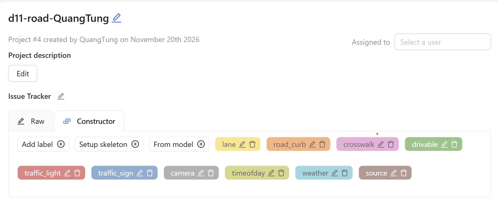
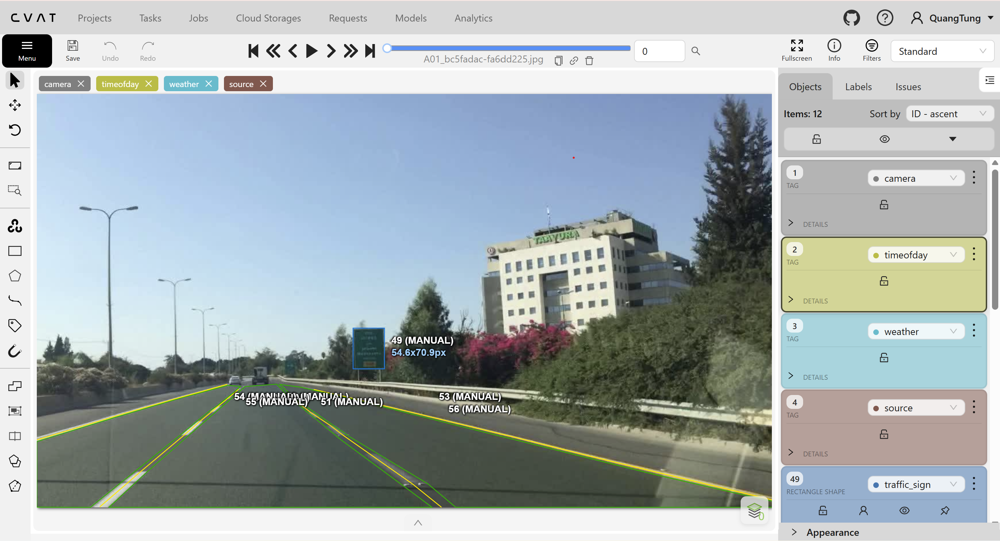
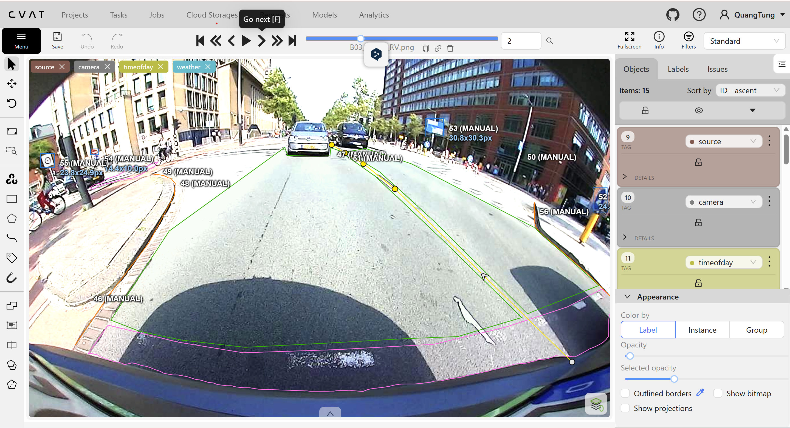
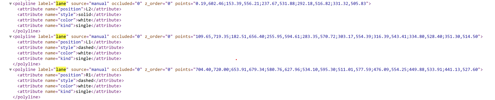

# Báo cáo cá nhân — Ngày 11
Họ tên: Nguyễn Quang Tùng               Mã học viên: 2A202603080  
Phiên bản CVAT (Help → About): v2.74.1  
Guideline: Road v1.0    Lần nộp (`revision` trong manifest): 1  
Thời điểm export (ngày giờ trên CVAT): 2026-11-20 15:14:16 UTC    Số lần nộp lại sau Rework: 0  

## 1. Kiểm project
| Mục | Đúng như guideline Road v1.0? | Ghi chú |
| --- | --- | --- |
| 6 label, đúng kiểu | Đúng | lane (polyline), road_curb (polyline), crosswalk (polygon), drivable (polygon), traffic_light (rectangle), traffic_sign (rectangle) |
| Thuộc tính và giá trị | Đúng | Khớp 100% cấu hình trong `configs/road_v1_labels.json` |
| 4 tag ảnh | Đúng | camera, timeofday, weather, source (mỗi tag có thuộc tính select `value`) |
Cách kết thúc polyline trên bản CVAT này: Bấm phím **N** (hoặc click vào điểm cuối).  
Cách đặt tag ảnh trên bản CVAT này: Chọn công cụ **Tag** ở thanh bên trái, chọn label tag, sau đó mở bảng **Objects → Details** để chọn đúng giá trị trong danh sách `value`.  

## 2. Số lượng đã gán
| Task | Ảnh | lane | road_curb | crosswalk | drivable | traffic_light | traffic_sign |
| --- | ---: | ---: | ---: | ---: | ---: | ---: | ---: |
| front | 12 | 31 | 10 | 8 | 26 | 22 | 19 |
| front-extra (đã làm 4 / 4) | 4 | 12 | 1 | 5 | 9 | 8 | 13 |
| fisheye | 8 | 8 | 11 | 12 | 12 | 4 | 5 |
| fisheye-extra (đã làm 4 / 4) | 4 | 0 | 3 | 4 | 3 | 0 | 0 |
| **Tổng cộng (28 ảnh full)** | **28** | **43** | **14** | **16** | **35** | **30** | **32** |

## 3. Bảng ca khó
| Ảnh | Nhãn | Phân vân giữa | Đã chọn | Lý do |
| --- | --- | --- | --- | --- |
| A04 | lane | position = L1 hay R1 cho vạch vàng đôi | L1 | Đường Mỹ lưu thông bên phải, vạch vàng đôi là tim đường phân chia chiều xe chạy, nằm bên trái làn xe đang đi. |
| A03 | lane | Dừng polyline trước đầu xe che hay vẽ nối qua | Nối xuyên qua và bật `occluded` | Theo quy tắc, đoạn bị che ngắn cần vẽ nối liên tục qua vật cản và bật cờ `occluded`. |
| A05 | road_curb | Vẽ lane hay road_curb cho mép đường bên phải | road_curb | Mép đường là vỉa hè không có vệt sơn kẻ thì bắt buộc vẽ polyline `road_curb`. |
| A13 | lane | Phân biệt L1, R1, R2 trong ca mưa trơn trượt | L1 vạch vàng, R1 vạch trắng đứt, R2 vạch trắng liền | Xác định chuẩn thứ tự vạch từ trái sang phải, không bị nhầm lẫn giữa L1 và R1. |
| B06 | lane | position L1/R1 hay other | other | Camera nhìn bên hông trái (MVL) không xác định làn phía trước xe chạy, theo quy tắc phải gán `other`. |
| B11 | lane | Gán hay không gán các vạch ô đỗ xe | Bỏ qua vạch ô đỗ xe | Theo quy tắc Fisheye, chỉ gán vạch làn dọc, vạch ô đỗ xe không gán lane để tránh lỗi thừa nhãn QC1-03. |
| B02 | traffic_light | edge_zone bật hay tắt | bật | Cụm đèn nằm ở rìa ngoài vòng tròn ảnh mắt cá (ngoài 80% bán kính góc nhìn). |

## 4. Phiếu QC 1 nhận được
Bạn kiểm lô của tôi: Tự kiểm định độc lập (Self-Audit)  Quyết định nhận được: Release  
| Mã lỗi | Số lỗi | Đồng ý? | Đã sửa? |
| --- | ---: | --- | --- |
| QC1-01 (camera tag) | 0 | Đồng ý | Đã rà soát đủ 28/28 ảnh, tag camera khớp 100% |
| QC1-02 (đủ L1/R1) | 0 | Đồng ý | Các ảnh A05, A06, A07, A09, A14 không có vạch là do địa hình thực tế, được miễn theo quy định |
| QC1-03 (position) | 0 | Đồng ý | Đã chuẩn hóa toàn bộ thuộc tính L1/R1/other |

## 5. Kiểm file export
| File | Mở lại được? | Số shape ảnh 1 (job / file) | Số shape ảnh 2 (job / file) | Tag camera có trong XML? |
| --- | --- | --- | --- | --- |
| `quangtung-front.zip` | Có (`road_check lint` PASS, 16 ảnh) | 8 (A01) / 8 | 7 (A02) / 7 | Có (`front`) |
| `quangtung-fisheye.zip` | Có (`road_check lint` PASS, 12 ảnh) | 4 (B01) / 4 | 9 (B02) / 9 | Có (`fisheye_front`) |

## 6. Ảnh chụp màn hình
1. **Tab Labels của project `d11-road-QuangTung`:**  
   

2. **Một ảnh camera trước đã gán đủ đối tượng (làn, vùng lái, đèn/biển):**  
   

3. **Một ảnh fisheye đã gán, phóng to đoạn polyline cong:**  
   

4. **Một đoạn XML có `<polyline label="lane">`:**  
   

## 7. Tự đánh giá
Lỗi bạn mắc nhiều nhất hôm nay (theo mã QC1-xx), và cách tránh ở Ngày 20:  
- Lỗi dễ nhầm lẫn nhất là quên kiểm tra thuộc tính mặc định của CVAT (ví dụ tag camera hoặc position vạch làn). Cách tránh: Luôn mở bảng Objects → Details để rà soát kỹ từng đối tượng ngay sau khi vẽ.  
Nhãn của bạn đi vào model ở đâu? Chọn một lỗi đã sửa và nói nó làm model học sai thế nào:  
- Vạch lane đi vào mô hình nhận diện làn đường (như Row-Anchor / SVM). Nếu gán sai vạch tim đường thành R1 thay vì L1, mô hình sẽ học sai rằng bên phải xe là tim đường, dẫn đến hệ thống điều khiển vô lăng (LKA) lái xe đâm sang làn đường xe đối diện, gây nguy cơ tai nạn nghiêm trọng.

## 8. (Tùy chọn, buffer) Từ polyline đến đích row-anchor
| y | 720 | 680 | 640 | 600 | 560 |
| --- | ---: | ---: | ---: | ---: | ---: |
| x của chúng tôi (vạch R1 ảnh A01) | 704.4 | 654.7 | 597.9 | 540.8 | 484.7 |
| x của bạn kia | 705.1 | 655.0 | 598.2 | 541.0 | 485.0 |

TrẢ lời 3 câu:

1. Năm số x đó chính là đích mà một model row-anchor học cho vạch này. Nếu bạn dừng polyline sớm 40 px, hàng nào đổi thành "không có làn"?  
   - Hàng **y = 560** sẽ đổi thành "không có làn" (vì nằm ngoài phạm vi vẽ của polyline).
2. So với bạn được kiểm (cùng ảnh): ở hàng 720 và hàng 560, hai bạn lệch nhau bao nhiêu pixel? Lệch ở hàng nào ảnh hưởng LKA nhiều hơn (slide 25)?  
   - Ở hàng 720 lệch ~0.7 px, hàng 560 lệch ~0.3 px. Lệch ở **hàng 720 ảnh hưởng đến LKA nhiều hơn**, vì hàng 720 nằm sát bánh xe trước của xe mình nhất; một sai số nhỏ về tọa độ ở khoảng cách gần sẽ gây sai lệch lớn về góc đánh lái của vô lăng.
3. Nếu polyline vẽ từ xa về gần (ngược quy tắc 2), cách tính trên có đổi không? Script nào sẽ gặp khó?  
   - Về mặt toán học nội suy hình học thì tọa độ x không đổi, nhưng script trích xuất đặc trưng hoặc thuật toán huấn luyện dựa trên thứ tự index điểm (point ordering) sẽ bị đảo lộn chiều vector định hướng của làn, gây khó khăn cho các script xử lý tuần tự (như script nội suy hoặc mạng RNN/LSTM dự đoán quỹ đạo).
